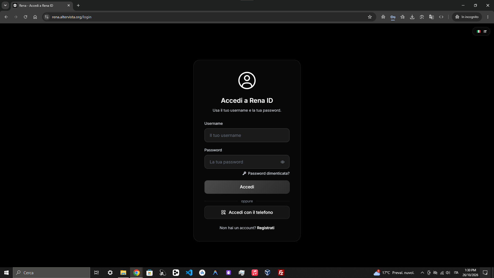
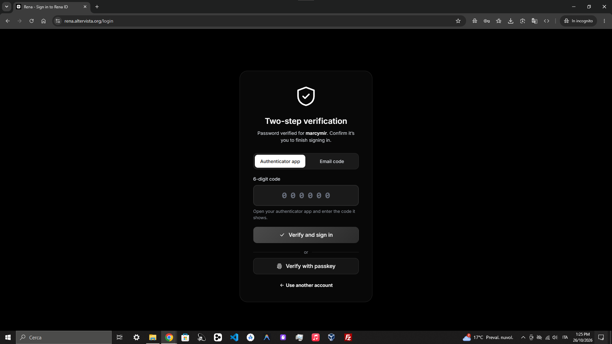
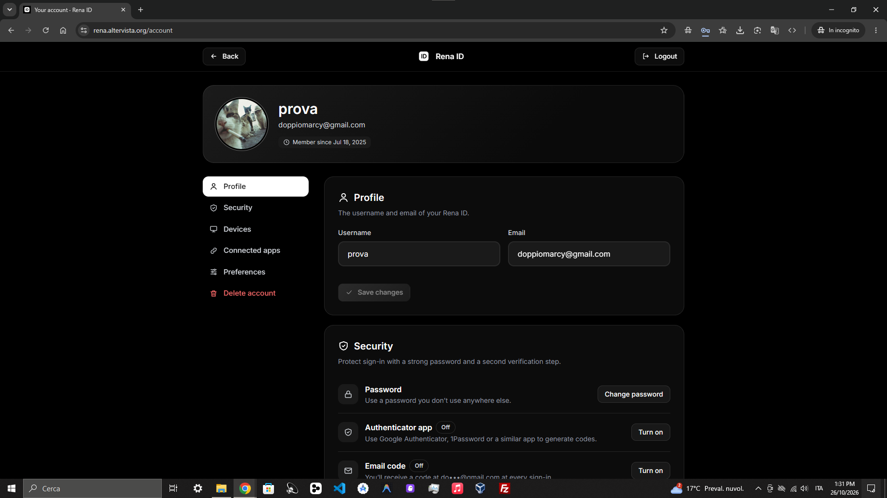
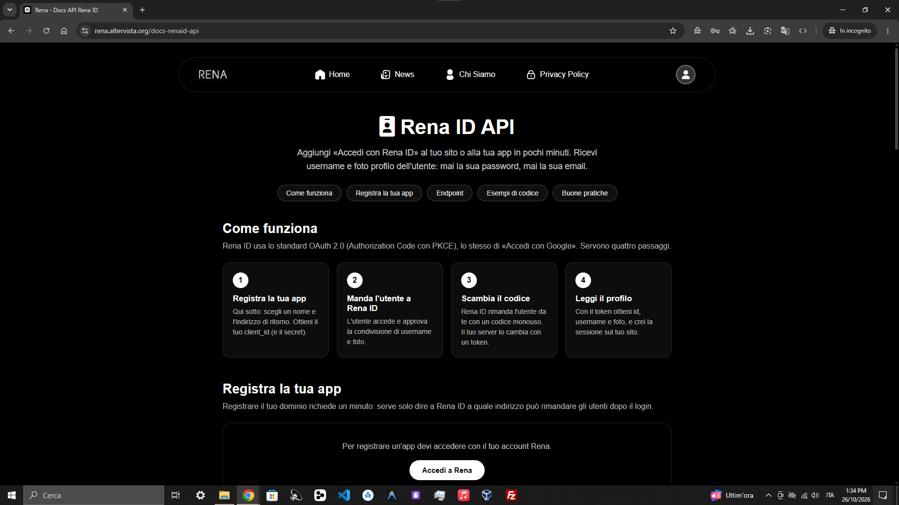

 

  

  # Rena ID

  **One identity. All Rena services.**

  Un unico account per accedere ai servizi Rena in modo semplice e sicuro.

  

    <a href="https://rena.altervista.org/rena-id.html">Website</a> ·
    <a href="https://rena.altervista.org/docs-renaid-api">API Documentation</a> ·
    <a href="https://rena.altervista.org/privacy-policy.html">Privacy Policy</a>
  

  
  
  

---

## Indice

- [Italiano](#italiano)
- [English](#english)

---

  

# Italiano

## Cos'è Rena ID?

**Rena ID** è il sistema di autenticazione centralizzato di Rena. Permette agli utenti di utilizzare un'unica identità per accedere ai servizi compatibili dell'ecosistema Rena.

Il progetto nasce con l'obiettivo di rendere l'accesso più semplice, mantenendo al tempo stesso un'attenzione particolare alla sicurezza, alla gestione dell'account e alla privacy.

## Funzionalità

<table>
  <tr>
    <td width="50%" valign="top">
      <h3>Autenticazione centralizzata</h3>
      Accedi ai servizi compatibili utilizzando un unico account Rena ID.
    </td>
    <td width="50%" valign="top">
      <h3>Verifica in due passaggi</h3>
      Un ulteriore livello di protezione per contribuire a proteggere l'accesso al tuo account.
    </td>
  </tr>
  <tr>
    <td width="50%" valign="top">
      <h3>Gestione dell'account</h3>
      Gestisci le informazioni del tuo profilo e le impostazioni disponibili.
    </td>
    <td width="50%" valign="top">
      <h3>Gestione degli accessi</h3>
      Strumenti dedicati al controllo e alla protezione dell'accesso al tuo account.
    </td>
  </tr>
  <tr>
    <td width="50%" valign="top">
      <h3>OAuth 2.0 e PKCE</h3>
      Un flusso di autorizzazione pensato per integrare Rena ID in siti web e applicazioni compatibili.
    </td>
    <td width="50%" valign="top">
      <h3>Supporto multipiattaforma</h3>
      Utilizzabile da smartphone e computer tramite browser.
    </td>
  </tr>
</table>

## Interfaccia

### Accesso

### Verifica in due passaggi

### Gestione dell'account

## Sicurezza e privacy

Rena ID è progettato per offrire un'esperienza di autenticazione centralizzata, con strumenti per la protezione dell'account e un flusso di autorizzazione dedicato alle integrazioni.

Il sistema utilizza **OAuth 2.0 Authorization Code con PKCE** per consentire ai servizi compatibili di richiedere l'autorizzazione dell'utente.

Le informazioni rese disponibili alle applicazioni dipendono dall'integrazione e dai dati previsti dal flusso Rena ID. Consulta la documentazione e l'informativa sulla privacy per maggiori dettagli.

- [Informativa sulla privacy](https://rena.altervista.org/privacy-policy.html)
- [Documentazione API](https://rena.altervista.org/docs-renaid-api)

## Inizia a usare Rena ID

1. Visita il [sito ufficiale di Rena ID](https://rena.altervista.org/rena-id.html).
2. Accedi al tuo account oppure registrati, se previsto.
3. Utilizza Rena ID per accedere ai servizi compatibili.

## API e integrazione

Vuoi integrare **Accedi con Rena ID** nel tuo sito web o nella tua applicazione?

Consulta la documentazione ufficiale per conoscere il flusso di autenticazione, le richieste supportate e i passaggi necessari per l'integrazione.

  
  
<a href="https://rena.altervista.org/docs-renaid-api">Apri la documentazione API</a>

### Tecnologie di autenticazione

- OAuth 2.0
- Authorization Code Flow
- PKCE

Il flusso consente ai servizi integrati di ottenere le informazioni dell'utente previste dall'autorizzazione, come un identificatore stabile, il nome utente e l'URL della foto profilo.

## Link utili

- **Sito ufficiale:** https://rena.altervista.org/rena-id.html
- **Documentazione API:** https://rena.altervista.org/docs-renaid-api
- **Informativa sulla privacy:** https://rena.altervista.org/privacy-policy.html
- **Supporto:** https://renasupporto.altervista.org
- **Novità su Rena ID:** https://rena.altervista.org/view-news?id=19&lang=it

---

  

# English

## What is Rena ID?

**Rena ID** is Rena's centralized authentication system. It allows users to use a single identity to access compatible services across the Rena ecosystem.

The project aims to make signing in easier while maintaining a strong focus on account security, access management, and privacy.

## Features

<table>
  <tr>
    <td width="50%" valign="top">
      <h3>Centralized authentication</h3>
      Sign in to compatible services using a single Rena ID account.
    </td>
    <td width="50%" valign="top">
      <h3>Two-step verification</h3>
      An additional layer of protection to help secure access to your account.
    </td>
  </tr>
  <tr>
    <td width="50%" valign="top">
      <h3>Account management</h3>
      Manage your profile information and available account settings.
    </td>
    <td width="50%" valign="top">
      <h3>Access management</h3>
      Tools designed to help you control and protect access to your account.
    </td>
  </tr>
  <tr>
    <td width="50%" valign="top">
      <h3>OAuth 2.0 and PKCE</h3>
      An authorization flow designed to integrate Rena ID into compatible websites and applications.
    </td>
    <td width="50%" valign="top">
      <h3>Cross-platform support</h3>
      Use Rena ID from smartphones and computers through a web browser.
    </td>
  </tr>
</table>

## Interface

### Sign in

### Two-step verification

### Account management

## Security and privacy

Rena ID is designed to provide a centralized authentication experience, with account protection tools and a dedicated authorization flow for integrations.

The system uses **OAuth 2.0 Authorization Code with PKCE** to allow compatible services to request user authorization.

The information made available to applications depends on the integration and the data provided by the Rena ID flow. Please refer to the documentation and privacy policy for further details.

- [Privacy Policy](https://rena.altervista.org/privacy-policy.html)
- [API Documentation](https://rena.altervista.org/docs-renaid-api)

## Getting started

1. Visit the [official Rena ID website](https://rena.altervista.org/rena-id.html).
2. Sign in to your account or register, where available.
3. Use Rena ID to access compatible services.

## API and integration

Want to integrate **Sign in with Rena ID** into your website or application?

Visit the official documentation to learn about the authentication flow, supported requests, and the steps required for integration.

  
  
<a href="https://rena.altervista.org/docs-renaid-api">Open the API documentation</a>

### Authentication technologies

- OAuth 2.0
- Authorization Code Flow
- PKCE

The flow allows integrated services to obtain the user information permitted by the authorization, such as a stable user identifier, username, and profile photo URL.

## Useful links

- **Official website:** https://rena.altervista.org/rena-id
- **API documentation:** https://rena.altervista.org/docs-renaid-api
- **Privacy Policy:** https://rena.altervista.org/privacy-policy
- **Support:** https://renasupporto.altervista.org
